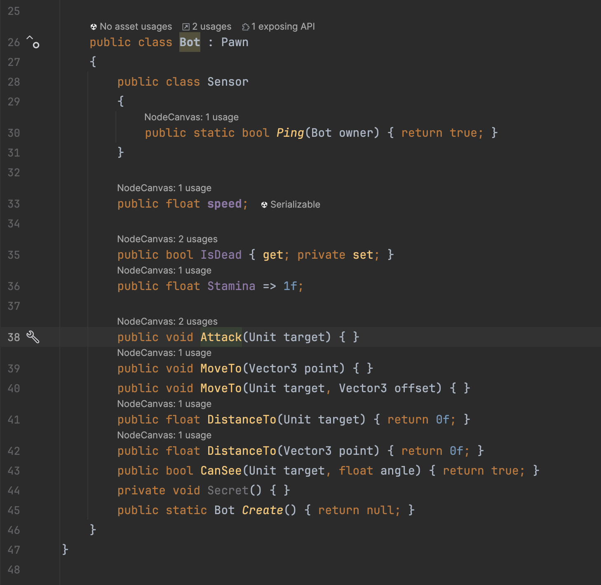
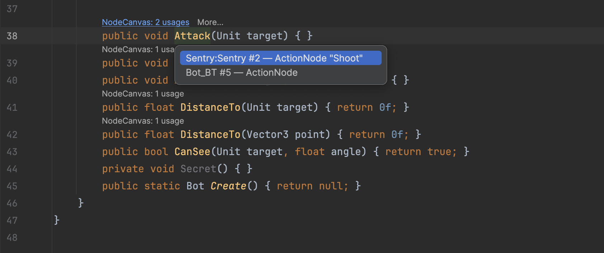
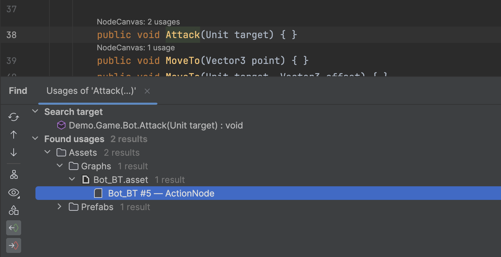
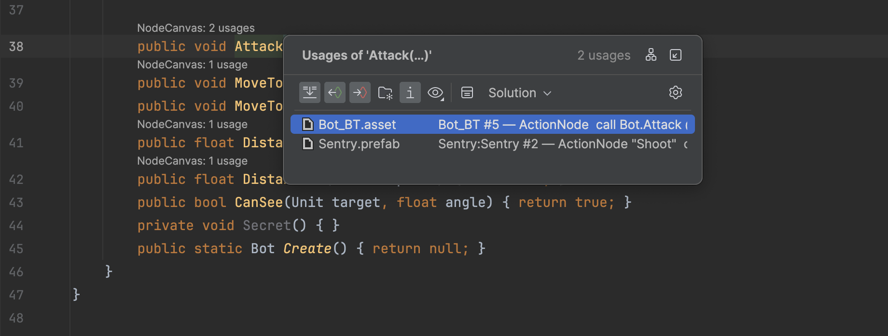
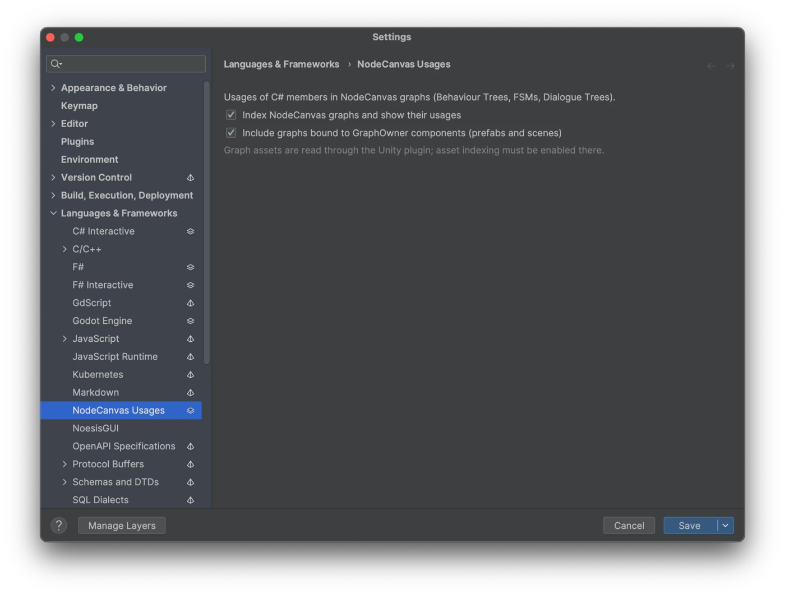

# NodeCanvas Usages for Rider

[](https://plugins.jetbrains.com/plugin/35036-nodecanvas-usages)

A JetBrains Rider plugin that makes C# members used by [NodeCanvas](https://nodecanvas.paradoxnotion.com/) graphs
(Behaviour Trees, FSMs, Dialogue Trees) visible to the IDE.

NodeCanvas binds reflection tasks (`ExecuteFunction`, `CheckProperty`, `GetField`, …) to C# members by **string
name**, stored in the graph's serialized JSON inside Unity YAML assets. Rider cannot see those references: the members
are shown as unused, Find Usages misses them, and a rename silently breaks the graphs. This plugin indexes the graphs
and plugs them into Rider's own features.



> Not affiliated with Paradox Notion. The repository contains no NodeCanvas code, only a reader for its
> serialization format.

## Features

- **Code Vision**: `NodeCanvas: N usages` above methods, properties and fields used by graphs. Overloads are counted
  separately (by `_paramsInfo`). A base-class member used through a derived type counts as well. Click to see the
  list, for example `Bot_BT #5 — ActionNode "Shoot"`, and jump to the asset. With the Unity editor connected, each
  asset can also be opened (selected and pinged) in Unity.
- **Find Usages** (Alt+F7): graph references appear in a separate **NodeCanvas graphs** group.
- **Rename** of a method, property, field, type or namespace updates every reference in the graphs, including
  `$type`, `_type`, `_missingType`, `_baseInfo`, `_paramsInfo`, assembly-qualified generic arguments and the JSON
  inside `_recoveryState` of `MissingAction`/`MissingCondition`.
  - The YAML scalar is rewritten through decode → replace → encode with Unity's own line folding, so the result is
    byte-for-byte what Unity writes.
  - Files with nothing to change are not touched.
  - The changes are part of the refactoring: one undo reverts them, and they appear in the preview.
- **No false "unused" warnings**: members used only by graphs are treated as implicitly used. Getters and
  `GetField` count as reads, setters and `SetField` as writes.
- **Inspection**: *NodeCanvas graph references a missing member* warns on a type when a graph calls one of its
  members that no longer exists, or an overload whose parameters changed.
- **Inspection**: *NodeCanvas graph references this type by an old name* warns on a type when graphs refer to a
  type that no longer exists and has the same name (and generic arity), for example after *Move to namespace* or
  *Move type to outer scope*. The quick-fix rewrites the graphs to the type's current full name, the same way Rename
  does, as one undoable action.

Graphs are read from:
- graph assets (`*.asset`, `_serializedGraph`);
- graphs bound to `GraphOwner` components in prefabs and scenes (`_boundGraphSerialization`), labelled with the owner
  GameObject's name.

NodeCanvas 3.x serialization is supported.

## Installation

Requires **Rider 2025.3** (builds 253.\*) with the bundled **Unity Support** plugin enabled.

- **From disk**: download `ReSharperPlugin.NodeCanvasUsages-<version>.zip` from the
  [releases](../../releases) (or build it, see below), then in Rider go to *Settings → Plugins → ⚙ → Install Plugin from
  Disk…*, pick the zip and restart Rider.
- **From [JetBrains Marketplace](https://plugins.jetbrains.com/plugin/35036-nodecanvas-usages)**: *Settings → Plugins → Marketplace*, search for **NodeCanvas Usages**,
  install and restart.

Settings: *Settings → Languages & Frameworks → NodeCanvas Usages*. You can turn indexing on or off and choose whether bound graphs
(prefabs and scenes) count in Code Vision and Find Usages. Rename and the unused-symbol analysis always take all
graphs into account.

## How it works

- Asset files reach the plugin through the Unity plugin's PSI module. The index is a separate
  [deferred cache](https://github.com/JetBrains/resharper-unity) of the platform, built in the background and
  persisted between sessions. Like the Unity plugin's own asset index, it is updated per file when the file
  changes on disk or in an editor. It does not touch the Unity plugin's YAML index.
- A byte-level pre-filter (`_serializedGraph` / `_boundGraphSerialization`) skips files without graphs, so large scenes
  are never decoded. On a synthetic project with ~4000 assets (including 3 × 50 MB scenes) and 60 graphs, this
  plugin's own indexing work takes about 0.3 s.
- If the solution has no `NodeCanvas.Framework.Graph` type (from sources or a DLL), the plugin does nothing.
- A member is matched the way NodeCanvas' reflection resolves it:
  - the type by its CLR name (nested types with `+`), as written in `_baseInfo`;
  - then the member by name, searching base classes first (`get_X`/`set_X` → property `X`);
  - the overload by `_paramsInfo`.

## Limitations

- Asset indexing must be enabled in the Unity plugin (it is by default). Projects must use **Force Text** asset
  serialization.
- *Move to namespace* and *Move type to outer scope* do not update graphs themselves: these refactorings have no
  extension point for participants. Afterwards the moved type is marked by the old-name inspection; apply its
  quick-fix (or use **Rename** on the type or namespace instead of moving it).
- Graphs stored in an external JSON file (`_externalSerializationFile`) are not supported.
- Find Usages shows no preview pane for graph usages. Rider does not preview usages in Unity YAML assets, and the
  Unity plugin's own asset usages have no preview either.
- "Open in Unity" selects the asset in the Project window. It cannot select a node inside the NodeCanvas editor.

## Screenshots

Code Vision popup: each graph reference as `graph #node — node type "name"`. Bound graphs are shown as
`Prefab:Owner`. Click a line to open the asset.



Find Usages (Alt+F7), grouped by folder and asset:



Show Usages (Alt+click), with the task kind and member for each reference:



Settings › Languages & Frameworks › NodeCanvas Usages:



## Building

Requirements:
- .NET SDK 9+;
- Rider 2025.3.4 locally, to build against it instead of downloading the SDK distribution (~3 GB).

The Gradle wrapper downloads its own JDK.

```bash
./gradlew buildPlugin -PLocalRiderPath=/Applications/Rider.app   # → output/*.zip
dotnet test src/dotnet/NodeCanvasUsages.Core.Tests              # format tests, any OS
./gradlew testDotNet                                             # ReSharper SDK tests (Windows)
```

- **Supported Rider version.** It is set in two places, which change together: `ProductVersion`, `SinceBuild` and
  `UntilBuild` in `gradle.properties`, and `SdkVersion` in `src/dotnet/Plugin.props`.
- **Manual testing.** `scripts/make-sample-project.sh` turns `testData/project` into a solution Rider opens as a
  Unity project (`build/SampleUnityProject`). Run it with
  `./gradlew runIde -PLocalRiderPath=/Applications/Rider.app -PRunIdeSolution=build/SampleUnityProject/SampleUnityProject.sln`.
  The sandbox needs a Rider license.

### Layout

| Path | Contents |
|---|---|
| `src/dotnet/NodeCanvasUsages.Core` | SDK-free format code: YAML scalar codec, Unity YAML container, FullSerializer JSON, scanner, rewriter |
| `src/dotnet/NodeCanvasUsages.Core.Tests` | NUnit tests on `testData` (round trip, exact reference lists, byte-for-byte renames vs. golden files) |
| `src/dotnet/ReSharperPlugin.NodeCanvasUsages` | Backend: index, resolver, Find Usages, Rename, usage suppressor, inspection; `Rider/` holds Code Vision, navigation and the options page |
| `src/dotnet/ReSharperPlugin.NodeCanvasUsages.Unity` | Optional "Open in Unity" integration, loaded only with the Unity plugin |
| `testData/project` | Synthetic Unity project with graphs of every kind |
| `testData/golden` | Expected graph files after member and type renames (compared byte for byte) |

## License

[MIT](LICENSE)
